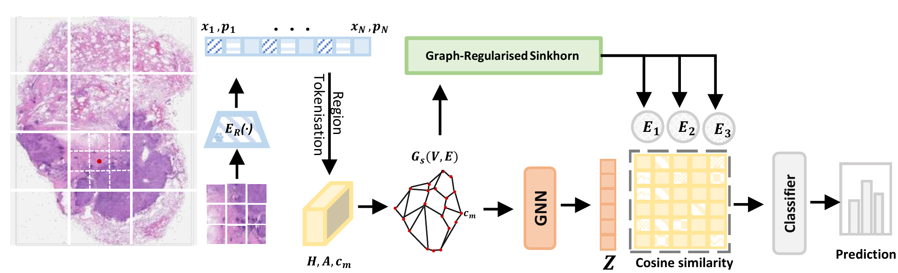
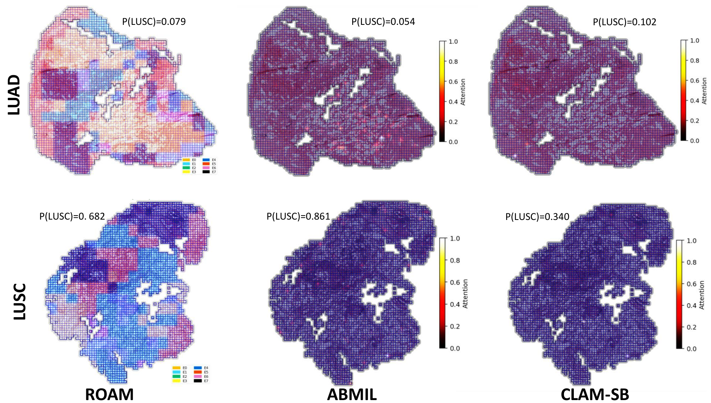
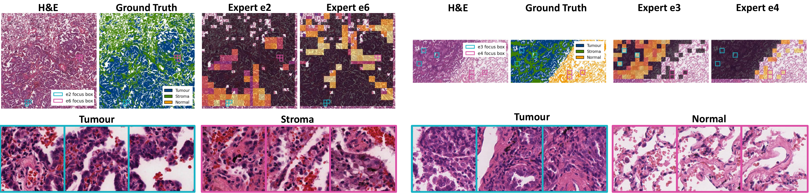

# 🧭 ROAM: Region-Graph Optimal Transport Routing for Mixture-of-Experts Whole-Slide Image Classification

**IEEE BIBM 2026**

**Authors**: Xin Tian<sup>1</sup>, Jiuliu Lu<sup>2</sup>, Ephraim Tsalik<sup>3</sup>, Bart Wanders<sup>2</sup>, Colleen Knoth<sup>3</sup>, Julian Knight<sup>1</sup>

<sup>1</sup> Centre for Human Genetics, University of Oxford, Oxford, UK<br>
<sup>2</sup> Beckman Coulter Diagnostics, Brea, CA, USA<br>
<sup>3</sup> Danaher Corporation, Washington, DC, USA

[](https://arxiv.org/abs/2604.07298)


---

## Overview

ROAM is a multiple instance learning (MIL) model for whole-slide images (WSIs).
It takes frozen patch features with their coordinates, groups the patches into tissue
regions, and sends each region to a few experts with optimal transport (OT).

<p align="center">
  
</p>

1. **Region tokens.** Patches are binned on a 16×16 grid, giving up to 256 regions.
   Each region keeps its mean feature, its size and its centre.
2. **Routing GNN.** A 2-layer GATv2 runs on a k-nearest-neighbour graph (k = 8) of region
   centres. Its output is used only to decide the routing.
3. **OT routing with expert capacity.** The cost of sending a region to an expert is
   1 − cos(routing embedding, expert prototype). A region's mass grows with its size and is
   boosted when it differs from its neighbours. Each of the E = 8 experts can take 1/E of
   the total. Sinkhorn solves the transport in T = 20 steps.
4. **Graph regularisation.** Three times during Sinkhorn, each region's transport plan is
   smoothed towards its neighbours (λ<sub>s</sub> = 0.1) and then re-normalised.
5. **Expert pooling.** Each region keeps its top-2 experts. Each expert is a
   gated-attention pooler whose attention is biased by log(routing weight).
6. **Fusion.** Gated attention combines the 8 experts, together with a summary of how much
   each expert received. An MLP makes the slide prediction.

The model is in [`src/models/roam.py`](src/models/roam.py).

## Repository

| Path | What it does |
|---|---|
| `src/models/roam.py` | the ROAM model |
| `src/train.py` | trains one fold and scores it |
| `src/eval.py` | re-scores a saved checkpoint, no training |
| `src/data/dataset.py` | reads feature files (`.h5`, or `.pt` + coordinate `.h5`) |
| `src/utils/metrics.py` | AUC, balanced accuracy, F1, QWK |
| `splits/` | slide lists: label, patient, fold, feature path |
| `scripts/` | download, cross-validation, ablations, summary, cost, routing maps, WSSS4LUAD |
| `tests/` | quick checks that the code runs (random data) |
| `assets/` | figures |

**How train, eval and tests fit together**

| Step | Command | Input | Output |
|---|---|---|---|
| Train one fold | `python -m src.train` | split file + features | `best_model.pt`, `summary.json`, `val_preds.csv` (+ `external_*`) |
| Train all 5 folds | `bash scripts/run_cv.sh` | same | one folder per fold |
| Mean ± std over folds | `python -m scripts.summarize` | `summary.json`, `external_metrics.json` | table on screen |
| Re-score a checkpoint | `python -m src.eval` | `best_model.pt` + `config.json` | `eval_*` files |
| Check the code | `pytest` | random data | pass / fail |

For fold *k*, `src.train` trains on the other four folds and scores fold *k*.
For NSCLC it also scores all 2,206 CPTAC slides (the external test set).
`tests/` only checks the code; it is not a data split.

## Installation

```bash
git clone https://github.com/xintian-99/ROAM.git && cd ROAM
conda create -n roam python=3.10 -y && conda activate roam
pip install torch --index-url https://download.pytorch.org/whl/cu118   # pick the build for your CUDA
pip install -r requirements.txt
pytest -q                                                               # optional, a few minutes on CPU
```

Tested with Python 3.10, PyTorch 2.7.1 and CUDA 11.8.
ROAM needs no graph library: the GATv2 layer is written in plain PyTorch.

## Data

We use public patch features. No features were re-extracted from the slides.
You only need the raw slides to add new cohorts or to draw routing maps on the tissue.

**Datasets**

| Task | Labels | Slides (patients) | Raw slides |
|---|---|---|---|
| NSCLC | TCGA-LUAD (0) vs TCGA-LUSC (1) | 1,043 (946) | GDC: [TCGA-LUAD](https://portal.gdc.cancer.gov/projects/TCGA-LUAD), [TCGA-LUSC](https://portal.gdc.cancer.gov/projects/TCGA-LUSC) |
| NSCLC, external test | CPTAC-LUAD (0) vs CPTAC-LSCC (1) | 2,206 (453) | TCIA: [CPTAC-LUAD](https://www.cancerimagingarchive.net/collection/cptac-luad/), [CPTAC-LSCC](https://www.cancerimagingarchive.net/collection/cptac-lscc/) |
| BRCA | IDC (0) vs other (1) | 1,126 (1,055) | GDC: [TCGA-BRCA](https://portal.gdc.cancer.gov/projects/TCGA-BRCA) |
| CRC | TCGA-COAD (0) vs TCGA-READ (1) | 600 (591) | GDC: [TCGA-COAD](https://portal.gdc.cancer.gov/projects/TCGA-COAD), [TCGA-READ](https://portal.gdc.cancer.gov/projects/TCGA-READ) |
| PANDA | ISUP grade 0–5 | 10,202 | Kaggle: [PANDA challenge](https://www.kaggle.com/competitions/prostate-cancer-grade-assessment) |
| Interpretability | tumour / stroma / normal masks | 22 regions | [WSSS4LUAD challenge](https://wsss4luad.grand-challenge.org/) |

**Features**

| Task | UNI2-h ([MahmoodLab/UNI2-h-features](https://huggingface.co/datasets/MahmoodLab/UNI2-h-features)) | GigaPath ([Dearcat/CPathPatchFeature](https://huggingface.co/datasets/Dearcat/CPathPatchFeature)) | Split files |
|---|---|---|---|
| NSCLC | `TCGA/TCGA-LUAD`, `TCGA/TCGA-LUSC` | `nsclc` (1,016 slides) | `uni2h_tcga_nsclc.csv`, `gigapath_tcga_nsclc.csv` |
| NSCLC, external test | `CPTAC/cptac_luad_part1`, `cptac_luad_part2`, `cptac_lscc` | not available | `uni2h_cptac_nsclc.csv` |
| BRCA | `TCGA/TCGA-BRCA_IDC`, `TCGA/TCGA-BRCA_OTHERS` | `brca` (1,114 slides) | `uni2h_tcga_brca.csv`, `gigapath_tcga_brca.csv` |
| CRC | `TCGA/TCGA-COAD`, `TCGA/TCGA-READ` | not available | `uni2h_tcga_crc.csv` |
| PANDA | `PANDA/panda` | `panda` (9,055 slides) | `uni2h_panda.csv`, `gigapath_panda.csv` |

- **UNI2-h** ([encoder](https://huggingface.co/MahmoodLab/UNI2-h)): one `.h5` per slide with
  `features` (1, N, 1536) and `coords` (1, N, 2). The dataset is gated: accept its terms on
  Hugging Face, then run `huggingface-cli login`.
- **GigaPath** ([encoder](https://huggingface.co/prov-gigapath/prov-gigapath)): features in
  `<dataset>/gigap/pt_files/<slide>.pt` (N, 1536), coordinates in `<dataset>/patches/<slide>.h5`.
  Released by Tang et al. with [E2E-WSI-ABMILX](https://github.com/DearCaat/E2E-WSI-ABMILX).
  The GigaPath split files keep only slides that have both files.
- **Your own cohort or encoder**: extract features with [TRIDENT](https://github.com/mahmoodlab/TRIDENT)
  or [CLAM](https://github.com/mahmoodlab/CLAM), save one `.h5` per slide with `features` and
  `coords`, copy one of our split files and change `feature_path`. Set `--d_in` if the feature
  size is not 1536.

**Download**

```bash
# UNI2-h (gated: needs Hugging Face access)
python scripts/download_features.py --encoder uni2h --tasks nsclc cptac brca crc panda --out /data/UNI2-h-features
# GigaPath
python scripts/download_features.py --encoder gigapath --tasks nsclc brca panda --out /data/CPathPatchFeature
```

UNI2-h sizes: TCGA-NSCLC ≈ 71 GB, CPTAC ≈ 100 GB, BRCA ≈ 64 GB, CRC ≈ 22 GB, PANDA ≈ 32 GB.
The script unpacks each archive to `<out>/<TCGA|CPTAC|PANDA>/<archive>/<slide>.h5`,
which is the layout the split files expect.

**Split files** (`splits/*.csv`)

Columns: `slide_id, case_id, label, label_str, fold, feature_path` (+ `coords_path` for GigaPath).
Paths are relative to the folder you pass with `--feature_root`.

- **TCGA**: `StratifiedGroupKFold(n_splits=5, shuffle=True, random_state=0)`, grouped by
  patient. All slides of a patient are in the same fold, and each fold has a similar label ratio.
- **PANDA**: `StratifiedKFold(n_splits=5, shuffle=True, random_state=0)` by ISUP grade
  (one slide per case). We use the curated 10,202-slide label table of
  [E2E-WSI-ABMILX](https://github.com/DearCaat/E2E-WSI-ABMILX); the official training set has 10,616 slides.
- **GigaPath**: each slide keeps its fold from the UNI2-h split.
- **CPTAC**: external test only (`fold = -1`); no patient is shared with TCGA.

Running the scikit-learn call above on a split file reproduces its folds (checked with scikit-learn 1.7).

## Training and evaluation

Run all commands from the repository root.
`UNI2H_ROOT` and `GIGAPATH_ROOT` point at the downloaded features.

**One fold** (NSCLC, UNI2-h, with the CPTAC external test):

```bash
python -m src.train \
    --manifest splits/uni2h_tcga_nsclc.csv --external_manifest splits/uni2h_cptac_nsclc.csv \
    --feature_root $UNI2H_ROOT --fold 0 --output_dir outputs/uni2h/nsclc/roam/fold0
```

The defaults in `src/train.py` are the paper settings.

**5-fold cross-validation**

```bash
export UNI2H_ROOT=/data/UNI2-h-features GIGAPATH_ROOT=/data/CPathPatchFeature
bash scripts/run_cv.sh nsclc uni2h            # also scores CPTAC with every fold
bash scripts/run_cv.sh brca uni2h
bash scripts/run_cv.sh panda gigapath
bash scripts/run_ablations.sh                 # Table II variants (NSCLC, UNI2-h)
python -m scripts.summarize --out outputs     # mean ± std over folds, internal + CPTAC
```

Each fold writes `config.json`, `history.csv`, `best_model.pt`, `summary.json` and
`val_preds.csv` to `outputs/<encoder>/<task>/roam/fold<k>/`, plus `external_metrics.json`
and `external_preds.csv` when there is an external set.
Folds run one after another; on a cluster, run one job per fold with `FOLDS=<k>`.

**Re-score a checkpoint** (writes `eval_*` files and leaves the training outputs untouched):

```bash
python -m src.eval --run_dir outputs/uni2h/nsclc/roam/fold0 --feature_root $UNI2H_ROOT
python -m src.eval --run_dir outputs/uni2h/nsclc/roam/fold0 --feature_root $UNI2H_ROOT --max_patches 0   # full bags
```

**Computational cost** (paper Sec. IV-A)

```bash
python -m scripts.benchmark_cost --manifest splits/uni2h_tcga_nsclc.csv --feature_root $UNI2H_ROOT --n 10000
```

The paper reports 3.31 M parameters, 16.4 GFLOPs and 8.9 ms per slide for ROAM, measured on
one NVIDIA A100 40 GB GPU (aggregator only, N = 10,000 patches, mean of 20 forward passes,
batch size 1). Latency depends on the GPU.

## Interpretability

**Routing maps** (paper Fig. 2). Export the expert of every patch for chosen slides, then
colour each patch by `expert` at its `x, y`:

```bash
python -m scripts.export_routing --run_dir outputs/uni2h/nsclc/roam/fold0 \
    --manifest splits/uni2h_cptac_nsclc.csv --feature_root $UNI2H_ROOT \
    --slides <slide_id> [<slide_id> ...] --out routing.csv
```

<p align="center">
  
  <br><em>Dominant expert per region on two CPTAC slides (top: LUAD, bottom: LUSC), next to ABMIL and CLAM-SB attention.</em>
</p>

**Tissue types** (paper Fig. 3). Embed the annotated WSSS4LUAD validation regions with UNI2-h
(needs `timm` and access to the gated UNI2-h weights), then score each expert's routing weight
against the tissue masks:

```bash
python -m scripts.interpretability.extract_wsss4luad_uni2h --wsss_root /data/WSSS4LUAD --out_dir /data/wsss4luad_uni2h
python -m scripts.interpretability.score_wsss4luad_experts --run_dir outputs/uni2h/nsclc/roam/fold0 \
    --feat_dir /data/wsss4luad_uni2h --out wsss4luad_expert_auc.csv
```

<p align="center">
  
  <br><em>H&amp;E, tissue masks and routing weights of selected experts on two WSSS4LUAD fields.</em>
</p>

## Settings

**ROAM** (defaults in `src/train.py`)

| Setting | Flag | Value |
|---|---|---|
| hidden size d | `--d_proj` | 512 |
| region tokens M (grid) | `--n_tokens` | 256 (16×16) |
| region graph neighbours | `--k_neighbors` | 8 |
| routing GNN | `--gnn_layers`, `--gnn_heads`, `--gnn_dropout` | 2 GATv2 layers, 4 heads, 0.1 |
| experts E, top-k | `--num_experts`, `--topk` | 8, 2 |
| OT ε, Sinkhorn steps T | `--ot_eps`, `--sinkhorn_iters` | 0.1, 20 |
| graph regularisation λ<sub>s</sub>, rounds | `--lam_smooth`, `--smooth_iters` | 0.1, 3 |
| mass boost for distinct regions | `--lam_rare` | 0.2 |
| expert heads, expert attention size | `--expert_heads`, `--d_att` | 2, 64 (= d_att / 4) |
| routing-summary embedding | `--d_comp` | 64 |
| optimiser | `--lr`, `--weight_decay` | AdamW, 5e-4, 1e-4 |

**Ablations** (paper Table II; each changes one setting)

| Variant | Flag |
|---|---|
| I. no routing GNN (graph regularisation kept) | `--no_routing_gnn` |
| II. no graph regularisation (plain Sinkhorn, 20 steps) | `--smooth_iters 0` |
| III. softmax routing (no capacity limit) | `--routing softmax` |
| IV. no OT-guided pooling (no log γ term) | `--no_ot_modulation` |
| V. OT-guided pooling, routing weights detached | `--ot_mod_detach` |

Softmax routing also drops the graph term, which lives inside Sinkhorn, and each region's
weights sum to 1 instead of to its mass. Without the log γ term, every expert looks at all
regions, not only the ones routed to it.

**Training protocol**

- **Optimiser**: AdamW. Learning rate warms up linearly from 0.1 × lr over 5 epochs, then
  follows a cosine decay (updated once per epoch).
- **Training loop**: one slide per batch, dropout 0.25, gradient clipping at 1.0,
  at most 200 epochs, early stopping on AUC (QWK for PANDA) with patience 20.
- **Loss**: binary tasks use one logit with `BCEWithLogitsLoss`; PANDA uses 6-class cross-entropy.
- **Bag size**: in training, bags with more than 4,096 patches (`--max_patches`) get a new
  random subset each epoch. In evaluation (`src.train`, and `src.eval` by default), the first
  4,096 patches in file order are used; `src.eval --max_patches 0` uses all patches.
- **Metrics**: slide-level AUC for binary tasks, quadratic weighted kappa for PANDA;
  mean ± population std over the five folds.
- **Reproducibility**: seeds are fixed (`--seed 0`). Some CUDA operations are
  non-deterministic, so GPU training reruns can differ slightly. Re-scoring a checkpoint on GPU
  reproduces its stored predictions; on CPU, rounding differences change a small fraction of
  predictions, and AUC can move in the fourth decimal.

## Acknowledgements

- **Features**: UNI2-h features by the [Mahmood Lab](https://huggingface.co/datasets/MahmoodLab/UNI2-h-features);
  GigaPath features ([CPathPatchFeature](https://huggingface.co/datasets/Dearcat/CPathPatchFeature))
  and the curated PANDA labels by Tang et al. ([E2E-WSI-ABMILX](https://github.com/DearCaat/E2E-WSI-ABMILX)).
- **Encoders**: [UNI2-h](https://huggingface.co/MahmoodLab/UNI2-h) (Chen et al., Nat. Med. 2024)
  and [Prov-GigaPath](https://huggingface.co/prov-gigapath/prov-gigapath) (Xu et al., Nature 2024).
- **Data**: [TCGA](https://portal.gdc.cancer.gov/), [CPTAC](https://www.cancerimagingarchive.net/),
  [PANDA](https://www.kaggle.com/competitions/prostate-cancer-grade-assessment) and
  [WSSS4LUAD](https://wsss4luad.grand-challenge.org/).
- **Building blocks**: GATv2 ([Brody et al., ICLR 2022](https://arxiv.org/abs/2105.14491)),
  Sinkhorn optimal transport ([Cuturi, NeurIPS 2013](https://arxiv.org/abs/1306.0895)) and
  gated attention pooling ([Ilse et al., ICML 2018](https://proceedings.mlr.press/v80/ilse18a.html)).

## Citation

```bibtex
@inproceedings{tian2026roam,
  title     = {Region-Graph Optimal Transport Routing for Mixture-of-Experts
               Whole-Slide Image Classification},
  author    = {Tian, Xin and Lu, Jiuliu and Tsalik, Ephraim and
               Wanders, Bart and Knoth, Colleen and Knight, Julian},
  booktitle = {Proc. IEEE Int. Conf. Bioinformatics and Biomedicine (BIBM)},
  year      = {2026}
}
```

GitHub's **Cite this repository** button uses the same entry (`CITATION.cff`).
If you use the features or data, please also cite UNI2-h, Prov-GigaPath, CPathPatchFeature,
TCGA, CPTAC and PANDA.

## Contact

Xin Tian (xin.tian@well.ox.ac.uk), Centre for Human Genetics, University of Oxford.

## Compared methods

Table I of the paper compares ROAM with these methods on the same features, splits and
training loop (AdamW, lr 2e-4, weight decay 1e-5; MambaMIL with at most 512 patches per bag).

| Method | Paper | Code |
|---|---|---|
| MeanPool / MaxPool | – | – |
| ABMIL | [Ilse et al., ICML 2018](https://proceedings.mlr.press/v80/ilse18a.html) | [AMLab-Amsterdam/AttentionDeepMIL](https://github.com/AMLab-Amsterdam/AttentionDeepMIL) |
| CLAM-SB / CLAM-MB | [Lu et al., Nat. Biomed. Eng. 2021](https://doi.org/10.1038/s41551-020-00682-w) | [mahmoodlab/CLAM](https://github.com/mahmoodlab/CLAM) |
| DSMIL | [Li et al., CVPR 2021](https://arxiv.org/abs/2011.08939) | [binli123/dsmil-wsi](https://github.com/binli123/dsmil-wsi) |
| DTFD-MIL | [Zhang et al., CVPR 2022](https://arxiv.org/abs/2203.12081) | [hrzhang1123/DTFD-MIL](https://github.com/hrzhang1123/DTFD-MIL) |
| ACMIL | [Zhang et al., ECCV 2024](https://arxiv.org/abs/2311.07125) | [dazhangyu123/ACMIL](https://github.com/dazhangyu123/ACMIL) |
| TransMIL | [Shao et al., NeurIPS 2021](https://arxiv.org/abs/2106.00908) | [szc19990412/TransMIL](https://github.com/szc19990412/TransMIL) |
| ILRA | [Xiang et al., ICLR 2023](https://openreview.net/forum?id=01KmhBsEPFO) | [jinxixiang/low_rank_wsi](https://github.com/jinxixiang/low_rank_wsi) |
| RRT-MIL | [Tang et al., CVPR 2024](https://arxiv.org/abs/2402.17228) | [DearCaat/RRT-MIL](https://github.com/DearCaat/RRT-MIL) |
| MambaMIL | [Yang et al., MICCAI 2024](https://arxiv.org/abs/2403.06800) | [isyangshu/MambaMIL](https://github.com/isyangshu/MambaMIL) |
| TAD-Graph | [Wang et al., IEEE TMI 2025](https://doi.org/10.1109/TMI.2025.3545680) | [HKU-MedAI/TAD-Graph](https://github.com/HKU-MedAI/TAD-Graph) |
| MAMMOTH-ABMIL / -TransMIL | [Shao et al., ICLR 2026](https://openreview.net/forum?id=S5Io33pc78) | [mahmoodlab/MAMMOTH](https://github.com/mahmoodlab/MAMMOTH) |
| PAMoE | [Wu et al., CVPR 2025](https://openaccess.thecvf.com/content/CVPR2025/html/Wu_Learning_Heterogeneous_Tissues_with_Mixture_of_Experts_for_Gigapixel_Whole_CVPR_2025_paper.html) | [wjx-error/PAMoE](https://github.com/wjx-error/PAMoE) |
| OTSurv (as a slide classifier) | [Ren et al., MICCAI 2025](https://arxiv.org/abs/2506.20741) | [Y-Research-SBU/OTSurv](https://github.com/Y-Research-SBU/OTSurv) |
